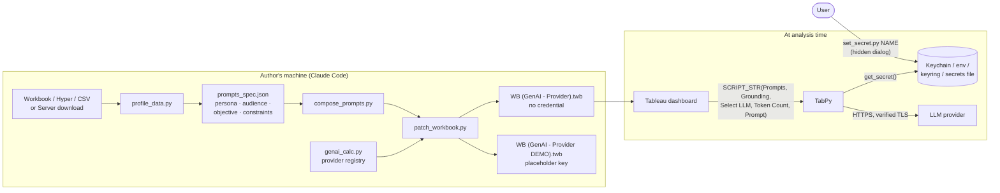

# tableau-genai-tabpy-skill

A [Claude Code](https://claude.com/claude-code) skill that turns a Tableau
dashboard into a grounded GenAI analysis tool through
[TabPy](https://github.com/tableau/TabPy) — against the LLM service you are
allowed to use (Ask Sage, OpenAI/ChatGPT, Amazon Bedrock incl. GovCloud,
Palantir AIP, Google Vertex, Azure OpenAI, Anthropic, or any
OpenAI-compatible gateway such as LiteLLM, vLLM or GenAI.mil) — **without
putting the API key in the workbook or in the chat**.

Given a workbook (or its data), the skill:

1. **Adapts the TabPy call** — generates the `Generative AI Response`
   `SCRIPT_STR` calculation for the chosen provider, with retries, size
   guards, readable errors and verified TLS.
2. **Stores the API key securely** — a command the user runs to paste the key
   into the macOS Keychain (or env / keyring / secrets file) via a hidden
   dialog; the LLM only ever sees `stored (N chars)`. A **demo** build with a
   visible key slot is also produced for walkthroughs.
3. **Assesses the data** behind the dashboard — `.twb`/`.twbx`, `.hyper`,
   `.csv`, `.tdsx`, or a workbook / data source downloaded from Tableau
   Server / Cloud (e.g. one built by the companion
   [tableau-prep-etl-skill](https://github.com/hal-force/tableau-prep-etl-skill)).
4. **Writes engineered prompts** for the dashboard's audience and workflow
   using a **persona / audience / objective / constraints / output format**
   template.
5. **Rebuilds the `Payload` calculated field** from the fields that matter,
   with a token budget estimate.
6. **Writes a new workbook** (`.twb` or `.twbx`) with the new calc, Payload,
   and a **`Prompts` string-list parameter** — full prompt as the value, a
   short description as *Display As* — wired into the response and added to
   the dashboard.

> Status: `v0.1.1-preview`. Verified end-to-end against mock providers (in
> process and through a real TabPy) and in Tableau Desktop with an
> OpenAI-compatible gateway. Live calls to every provider have **not** all
> been exercised — see [Limitations](#limitations).

---

## Contents

- [How it works](#how-it-works)
- [Supported providers](#supported-providers)
- [Requirements](#requirements)
- [Install](#install)
- [Quick start](#quick-start)
- [Using the patched dashboard](#using-the-patched-dashboard)
- [Security model](#security-model)
- [Testing](#testing)
- [Repository layout](#repository-layout)
- [Troubleshooting](#troubleshooting)
- [Limitations](#limitations)
- [Documentation index](#documentation-index)
- [License](#license)

---

## How it works



At run time the dashboard user selects marks and clicks **Analyze**; a
parameter action copies the concatenated **Payload** of the selected rows
into **Grounding**. The calc then:

1. checks the grounding is non-empty and under the token budget
   (`MAX_GROUNDING_TOKENS`, default 90 000; estimate = `LEN/4`);
2. assembles the prompt: selected **Prompts** template → optional
   `ANALYST QUESTION` from the **Prompt** box → `GROUNDING DATA` → a required
   self-assessment block (coverage, confidence, data gaps, recommended action)
   → a task reminder;
3. resolves the credential on the TabPy host (keystore build) or from the
   calc (demo build);
4. calls the provider in its native wire format, retrying 429/5xx
   (honouring `Retry-After`) and connection errors — but not read timeouts,
   so a slow model can't multiply the wait past Tableau's timeout; and
5. returns the model text, or a readable message for every failure (missing
   key, missing CA bundle, HTTP error, timeout, non-JSON or wrongly shaped
   response) — never a stack trace. Any credential value a provider echoes
   back in an error is replaced with `<redacted>`.

Calc anatomy and XML editing details:
[`docs/architecture.md`](docs/architecture.md),
[`reference/twb_patching.md`](reference/twb_patching.md).

## Supported providers

| Id | Service | Credential (keystore name) | Notes |
|---|---|---|---|
| `asksage` | Ask Sage (OpenAI-compatible route) | `asksage` | other tenants: `--url` |
| `asksage-native` | Ask Sage `/server/query` | `asksage`, `asksage.email` | token exchange per call; response shape unverified live |
| `openai` | OpenAI / ChatGPT API | `openai` | |
| `azure-openai` | Azure OpenAI (commercial / Government) | `azure-openai` | `--resource`; model = deployment |
| `bedrock` | Amazon Bedrock Converse (API key) | `bedrock` | `--region us-gov-west-1` for GovCloud |
| `bedrock-iam` | Amazon Bedrock via boto3 / SigV4 | optional access keys | instance role = no stored key |
| `palantir` | Palantir AIP LLM proxy | `palantir` | `--host`; routes Anthropic vs OpenAI shape |
| `vertex` | Google Vertex (express API key) | `vertex` | Gemini `generateContent` |
| `vertex-sa` | Google Vertex (service account) | `vertex.service_account` | needs `google-auth` or `gcloud` on TabPy host |
| `anthropic` | Anthropic Messages API | `anthropic` | |
| `gateway` | any OpenAI-compatible `/chat/completions` | `gateway` | `--url` required |

Details, model-id formats and guidance for DoD/IC networks:
[`reference/providers.md`](reference/providers.md).

## Requirements

- **Python 3.9+** with `requests` and `tableauhyperapi` for the authoring
  scripts (`tableauserverclient` for Server/Cloud; `certifi` for
  `ca_bundle.py`). See [`requirements.txt`](requirements.txt).
- **TabPy** reachable from Tableau (Desktop: *Help → Settings and
  Performance → Manage Analytics Extension Connection*). The TabPy Python
  needs `requests`; plus `boto3` for `bedrock-iam`, `google-auth` for
  `vertex-sa`, `keyring` for non-macOS keystores.
- **Tableau Desktop / Server** with analytics extensions and parameter
  actions (2019.2+; tested with 2025.x-format workbooks).
- **macOS** for Keychain storage and `ca_bundle.py`'s System-keychain export.
  Linux / Windows work with env vars, `keyring`, or the secrets file.
- **Claude Code** to run it as a skill (the scripts also work standalone).

## Install

```sh
git clone https://github.com/hal-force/tableau-genai-tabpy-skill.git ~/claude-projects/tableau-genai-tabpy-skill
cd ~/claude-projects/tableau-genai-tabpy-skill
python3 -m pip install -r requirements.txt

# make it available to Claude Code as a personal skill
mkdir -p ~/.claude/skills
ln -s ~/claude-projects/tableau-genai-tabpy-skill ~/.claude/skills/tableau-genai-tabpy
```

In Claude Code, ask for it in plain words — *"connect my DNFSB dashboard to
Ask Sage"*, *"adapt this TabPy LLM calc to Bedrock GovCloud"* — and the skill
([`SKILL.md`](SKILL.md)) drives the workflow below.

## Quick start

Standalone, without Claude Code (DNFSB example; replace names with yours):

```sh
cd ~/claude-projects/tableau-genai-tabpy-skill
WB=~/Documents/"My Tableau Repository"/Workbooks/dnfsb_full.twb

# 1. store the key -- hidden dialog / no-echo prompt, value never printed
python3 scripts/set_secret.py asksage
python3 scripts/set_secret.py asksage --check        # -> present (N chars)

# 2. (corporate / DoD networks) export trusted roots and test TLS
python3 scripts/ca_bundle.py --test https://api.asksage.ai/   # 401/403/404 = TLS OK

# 3. profile the workbook and its data
python3 scripts/profile_data.py "$WB" --out out/

# 4. write prompts (edit the spec for your audience first)
python3 scripts/compose_prompts.py examples/dnfsb/prompts_spec.json --out out/

# 5. patch -- keystore build (no credential in the file)
python3 scripts/patch_workbook.py "$WB" \
  --prompts out/prompts.json \
  --payload "Report ID=Report Id" "Week Ending=Week Ending Date" "Site=Site" \
            "Title=Report Title" "Report Content=Full Text" \
  --report out/patch_report.json \
  -- --provider asksage --mode keystore --tls ~/.tableau-genai/ca-bundle.pem

# 5b. optional demo build with a visible PASTE_YOUR_API_KEY_HERE slot
#     (same arguments, then:  -- --provider asksage --mode demo)

# 6. test the calc exactly as it sits in the new workbook (mock provider, no key)
python3 tests/test_workbook_calc.py ~/Documents/"My Tableau Repository"/Workbooks/"dnfsb_full (GenAI - Ask Sage).twb"
```

Data on Tableau Server / Cloud:

```sh
python3 scripts/server_io.py list-workbooks --search DNFSB
python3 scripts/server_io.py download-workbook "DNFSB Weekly Reports" --out /tmp/genai_src
# ... profile / compose / patch as above ...
python3 scripts/server_io.py publish "/tmp/genai_src/<name> (GenAI - Ask Sage).twbx" --project "GenAI Demos"
```

Every script's options: [`docs/cli.md`](docs/cli.md).

## Using the patched dashboard

| Control | What it does |
|---|---|
| **Prompts** (new list) | pick an engineered analysis — e.g. *Executive Safety Brief – BLUF of top safety issues for leadership*. The full persona/audience/objective/constraints prompt is the value. |
| **Prompt** (text box) | optional follow-up or focus ("Focus on Pantex"); used alone when Prompts = *Free text*. |
| **Select LLM** | model id sent to the provider (`--models` replaces the list). |
| **Analyze** button | parameter action: selected rows' Payload → Grounding. |
| **Generative AI Response** | the answer, followed by the self-assessment block. |

Output files are written next to the source as
`<name> (GenAI - <Provider>).twb[x]` and
`<name> (GenAI - <Provider> DEMO).twb[x]` (override with `--suffix`); the
original is never modified.

## Security model

Short version (full detail in [`reference/security.md`](reference/security.md)
and [`SECURITY.md`](SECURITY.md)):

- **Keystore build:** no credential in the workbook. `get_secret(name)` runs
  on the TabPy host: env `TABLEAU_GENAI_<NAME>` → macOS Keychain
  (service `tableau-genai`) → `keyring` → `~/.tableau-genai/secrets.json`.
  Missing → a dashboard message saying how to store it.
- **Demo build:** credential literal in the calc (placeholder by default).
  Laptop demos only; `server_io.py publish` refuses any workbook with a
  credential-looking literal (so an injected-key build can't be published);
  injected-key builds are written chmod 600.
- **Keys never transit the LLM.** `set_secret.py` reads from a hidden dialog,
  no-echo prompt, clipboard (cleared afterwards) or file. All scripts print
  only `present/stored (N chars)`.
- **Verified TLS** with a CA bundle instead of `verify=False`.
- **Detects** plaintext keys (quote-agnostic: `API_KEY = '…'`, Tableau's
  `""…""`, header dicts, `Bearer …`, parameter values, common `sk-` / `AKIA`
  / `AIza` / `gh*_` formats), saved Grounding values (data at rest in the
  `.twb`) and disabled TLS in existing workbooks. The patcher scans the whole
  output and refuses to write a keystore build that contains a credential,
  or any build in which the source workbook's key survives.
- **TabPy caveats you must handle:** DEBUG logging writes every script and
  argument (keys in demo calcs, grounding text) to disk; TabPy listens on all
  interfaces by default; the keystore is resolved on the *TabPy* host, so a
  Docker or Server TabPy needs env vars / a mounted secrets file, not your
  Keychain.
- **Data boundary:** the selected rows are sent to the provider. Match the
  provider's authorization (IL / FedRAMP level) to the data's classification
  before connecting.

## Testing

```sh
python3 tests/test_calc_e2e.py                               # every provider vs. a local mock (39 cases)
python3 tests/test_calc_e2e.py --tabpy http://127.0.0.1:9004 # same, through a real TabPy /evaluate
python3 tests/test_workbook_calc.py "WB (GenAI - X).twb" [--grounding-hyper DATA.hyper] [--tabpy URL]
python3 tests/test_workbook_calc.py "WB (GenAI - X).twb" --live --tabpy http://127.0.0.1:9004  # real provider, your key
```

- `tests/mock_providers.py` serves OpenAI, Anthropic, Bedrock Converse,
  Gemini, Ask Sage native and Palantir shapes on `127.0.0.1` and checks auth
  headers like the real services, plus failure-mode routes (429 +
  `Retry-After`, slow, wrong JSON shape, a provider that echoes the key).
  `test_calc_e2e.py` (39 cases) covers every provider, prompt assembly,
  every guard, 401 handling (key not echoed), retry / timeout behaviour,
  credential scrubbing, unreachable hosts, missing CA bundles, and the env /
  Keychain lookup paths. No network, no real key.
- `test_workbook_calc.py` extracts the `SCRIPT_STR` body from a patched
  workbook exactly as Tableau sends it, runs every Prompts member, the
  "no key stored" path and the empty-grounding guard. It handles both
  keystore and demo builds of the OpenAI-compatible wire (gateway, openai,
  azure-openai, asksage); other providers are covered by `test_calc_e2e.py`.
  The mock key is injected into the test copy of the calc only — never into
  TabPy's environment.
- `--live` prints only the first 300 characters of the model's answer.

## Repository layout

```
SKILL.md                 Claude Code skill entry point (workflow + hard security rules)
scripts/
  genai_calc.py          provider registry + SCRIPT_STR generator
  keystore.py            secret lookup/store (env, Keychain, keyring, file)
  set_secret.py          store a key without exposing it
  ca_bundle.py           export macOS trusted roots, probe TLS
  profile_data.py        profile twb/twbx/hyper/csv/tdsx, detect risks, recommend Payload
  compose_prompts.py     prompt spec -> Prompts parameter members
  payload.py             Payload formula builder
  patch_workbook.py      write the new .twb/.twbx (validated)
  server_io.py           Tableau Server/Cloud list, download, publish
  list_models.py         list provider model ids for Select LLM
tests/                   mock providers + end-to-end tests
reference/               providers, prompt engineering, security, TWB patching
docs/                    architecture, CLI reference, troubleshooting
examples/dnfsb/          worked example: profile, prompt spec, prompts, patch reports
tools/gen_cli_docs.py    regenerates docs/cli.md from each script's --help
```

## Troubleshooting

Common problems — `SSLCertVerificationError`, "No credential named …",
"TLS CA bundle … was not found on the TabPy host", Tableau timing out before
the model answers, the Prompts control not showing on a device layout — are
covered in [`docs/troubleshooting.md`](docs/troubleshooting.md).

## Limitations

- `asksage-native` response parsing follows the public docs; not yet
  verified against a live tenant. Prefer `asksage` (OpenAI-compatible).
- Only the `gateway` provider has been exercised live in Tableau Desktop;
  the others are verified against mocks of their wire formats.
- `vertex-sa` needs `google-auth` in the TabPy Python (or `gcloud` on the
  host).
- From a bare `.hyper`/`.csv` (no dashboard) the skill creates the
  parameters and calcs and prints the remaining manual steps; it does not
  design a new dashboard.
- A `.twb` that points at local `.hyper` files must be packaged (`.twbx`)
  before publishing.
- The grounding is not redacted; the token estimate is `LEN/4`.
- Tableau's analytics-extension timeout and TabPy's
  `TABPY_EVALUATE_TIMEOUT` must both exceed the calc's worst case: the
  request timeout (default 120 s) plus up to ~7 s of retry back-off, longer
  if a provider sends a large `Retry-After` (capped at 30 s per retry).

## Documentation index

| Doc | For |
|---|---|
| [`SKILL.md`](SKILL.md) | the agent workflow and non-negotiable security rules |
| [`docs/architecture.md`](docs/architecture.md) | how the generated calc and the patcher work |
| [`docs/cli.md`](docs/cli.md) | every script's options (generated) |
| [`docs/troubleshooting.md`](docs/troubleshooting.md) | symptoms → fixes |
| [`reference/providers.md`](reference/providers.md) | provider ids, endpoints, model ids, DoD/IC guidance |
| [`reference/prompt_engineering.md`](reference/prompt_engineering.md) | the prompt template and how to derive prompts from a workflow |
| [`reference/security.md`](reference/security.md) | key storage, TabPy host caveats, logging, data boundary |
| [`reference/twb_patching.md`](reference/twb_patching.md) | workbook XML structures the patcher edits |
| [`examples/dnfsb/README.md`](examples/dnfsb/README.md) | worked example walkthrough |
| [`SECURITY.md`](SECURITY.md) · [`CONTRIBUTING.md`](CONTRIBUTING.md) · [`CHANGELOG.md`](CHANGELOG.md) | project policies |

## License

Apache-2.0 — see [`LICENSE`](LICENSE). Not an official Tableau or Salesforce
product.
