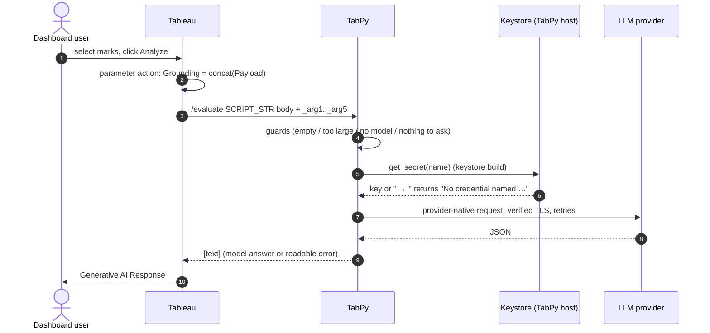
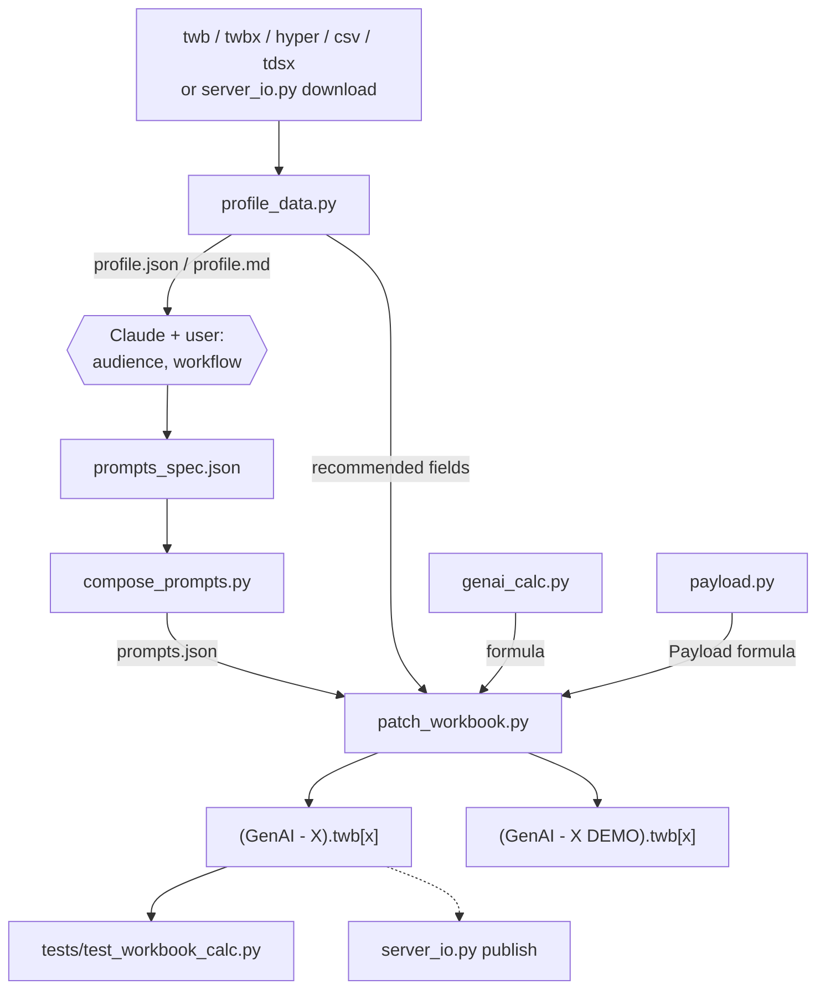

# Architecture

Two halves: **authoring-time scripts** that run on the author's machine (from
Claude Code or by hand), and the **generated calculation** that Tableau sends
to TabPy every time someone clicks *Analyze*.



## 1. The generated calculation

`genai_calc.py` assembles the Python body from fixed sections, then wraps it
as a Tableau formula:

```
SCRIPT_STR("<python, with "" for ">",
[Prompts],                  -> _arg1  engineered prompt (list parameter)
[Grounding],                -> _arg2  concatenated Payload of selected rows
[Select LLM],               -> _arg3  model id
[Grounding Token Count],    -> _arg4  INT(LEN([Grounding])/4)
[Prompt]                    -> _arg5  optional free-text question
)
```

With `--no-prompts-param` the legacy 4-argument form is produced
(`_arg1 = [Prompt]`, no `_arg5`).

TabPy wraps the body in a function, so top-level `return` works and every
`_argN` is a list (`scalar()` takes element 0). The body always returns a
one-element list.

| Section | Contents |
|---|---|
| `HEADER` | imports, `PROVIDER_LABEL`, `API_URL`, `MODEL`, budgets, `TLS_VERIFY` (`True`, `False`, or a CA-bundle path), `REQUEST_TIMEOUT`; returns a readable error if the CA-bundle path doesn't exist on the TabPy host |
| `SECRETS_KEYSTORE` / `SECRETS_DEMO` | `get_secret(name)` + `missing_secret(name)`. Keystore: env → `/usr/bin/security find-generic-password` → `keyring` → secrets JSON; values may be `b64:`-prefixed (used by `keystore.py` for values with quotes/newlines). Demo: a `DEMO_SECRETS` dict; the placeholder counts as empty |
| `GUARDS` | token count < 1 → "Click the Analyze …"; > `MAX_GROUNDING_TOKENS` → "split by …"; no model → "Select a model …" |
| `PROMPT_*` | template + optional `ANALYST QUESTION` + `GROUNDING DATA` + required self-assessment block + task reminder |
| `HTTP` | `post_json()` — retries 429/500/502/503/504 and network errors with exponential backoff (3 retries); every failure becomes `{'_error': …}`; response text is truncated |
| `WIRE_*` | one function per wire format (below) |
| footer | resolves credentials, calls the wire function, returns `[text]` |

### Wire formats

| Wire | Providers | Request | Auth |
|---|---|---|---|
| `openai_chat` | gateway, openai, azure-openai, asksage, vertex-sa | `POST …/chat/completions {model, messages[, max_tokens]}` | `Authorization: Bearer` (`api-key:` for Azure); vertex-sa mints an OAuth token from the stored service-account JSON (`google-auth`) or `gcloud auth print-access-token` |
| `anthropic_messages` | anthropic | `POST /v1/messages {model, max_tokens (default 4096), messages}` | `x-api-key`, `anthropic-version` |
| `bedrock_converse` | bedrock | `POST {base}/model/{urlquoted id}/converse` | `Authorization: Bearer <Bedrock API key>` |
| `bedrock_boto3` | bedrock-iam | `boto3.client('bedrock-runtime').converse(...)` | stored access keys if present, else the host's default credential chain |
| `gemini_generate` | vertex | `POST /v1/publishers/google/models/{model}:generateContent` (`google/` prefix stripped) | `x-goog-api-key` header (key never in the URL) |
| `asksage_query` | asksage-native | token exchange `POST /user/get-token-with-api-key`, then `POST /server/query` | `x-access-tokens` |
| `palantir_router` | palantir | model contains `claude`/`anthropic` → `/api/v2/llm/proxy/anthropic/v1/messages`, else `/api/v2/llm/proxy/openai/v1/chat/completions` | `Authorization: Bearer <Foundry token>` |

### Demo vs keystore

The only difference is the secrets section. Demo builds embed
`DEMO_SECRETS = {'name': 'PASTE_YOUR_API_KEY_HERE'}` unless
`--demo-key-from-keystore` injects the stored value at write time (the value
is written to disk, never printed, and the file is chmod 600).

## 2. Authoring scripts



### `profile_data.py`
- Parses the workbook XML (from `.twbx` via zip), lists datasources, logical
  tables, columns (caption ↔ internal name), parameters, sheets, dashboards
  and parameter actions.
- Detects the GenAI scaffold and risks: `PLAINTEXT_API_KEY` (pattern-based,
  never printed), `GROUNDING_SAVED_VALUE`, `TLS_VERIFY_DISABLED`.
- Profiles data from Hyper (the file is **copied to a temp dir first** so the
  user's extract is never locked or modified) or CSV: rows, nulls, empty
  strings, distinct counts, text lengths, samples; assigns a role
  (constant, date, url, long_text, id, title, category, measure, text).
- Recommends Payload fields (id, date, grouping, title, long text) with a
  tokens-per-record estimate and how many records fit the budget.

### `compose_prompts.py`
Renders each spec entry to `PERSONA / AUDIENCE / OBJECTIVE / CONSTRAINTS /
OUTPUT FORMAT` text, appends shared constraints, builds the Display As
(`label - summary`, ≤ 80 chars), replaces `"` with `'`, and appends a
free-text member with an empty value.

### `payload.py`
Builds `" Start of Record " + " Label: " + IFNULL(<ref>, "N/A") … + " End of
Record "`; non-strings get `STR()`, `--payload-max-chars` adds `LEFT()`.

### `patch_workbook.py`
See [`reference/twb_patching.md`](../reference/twb_patching.md) for the XML.
Order of operations:

1. load (`.twbx` → inner `.twb`), keep prologue/comments
2. `find_scaffold` (via the parameter action, then captions) or create one
3. Prompts parameter: create or update (`set_list_param` in every copy)
4. Payload: rebuild from `--payload`
5. Response: generate with `genai_calc`, rewrite caption refs to internal
   names, `set_formula_everywhere`
6. optional: Select LLM members (`--models`), Grounding reset, Prompt default
7. dashboard: `add_param_zone` in every layout
8. validate (refs, credentials, zone ids, re-parse) → write → report

### `server_io.py`
Thin wrapper over `tableauserverclient` with PAT auth. Credentials are read
from env, then the companion prep skill's Keychain items, then this skill's
keystore. `publish` scans the workbook for credentials first.

### `keystore.py` / `set_secret.py`
`keystore.py` is the authoring-side twin of the inlined `get_secret()` (same
order, same names) plus `store_secret` / `delete_secret`. Values containing
characters the `security` CLI mangles are stored `b64:`-encoded.
`set_secret.py` is the only entry point that ever handles a raw value, and it
reads it from a hidden dialog, a no-echo prompt, the clipboard or a file.
